[Projects](#projects) · [Stack](#stack) · [Activity](#activity) · [LinkedIn](https://www.linkedin.com/in/juliano-quirino-109296224/)

I build products end to end, from the database to the screen people use every day. tri-agent-swarm puts Claude Code, Codex and Gemini on one task as a single team. DomusApp runs a condo's residents and roles behind JWT auth. A point-of-sale app handles a small kiosk's sales, stock and cash, and my client sites are static, so they load fast.

## Projects

 

 

Kiosk POS and the client sites live in private repos.

  

## Stack

## Activity

Want to talk about any of this? Find me on [LinkedIn](https://www.linkedin.com/in/juliano-quirino-109296224/).
